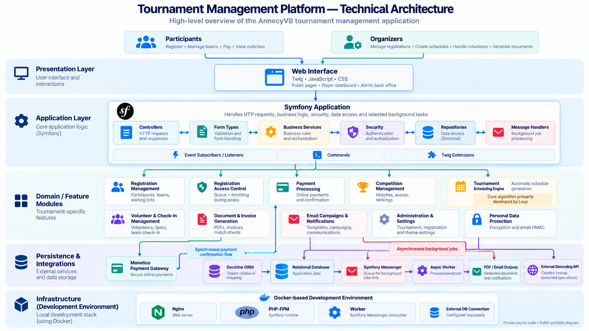
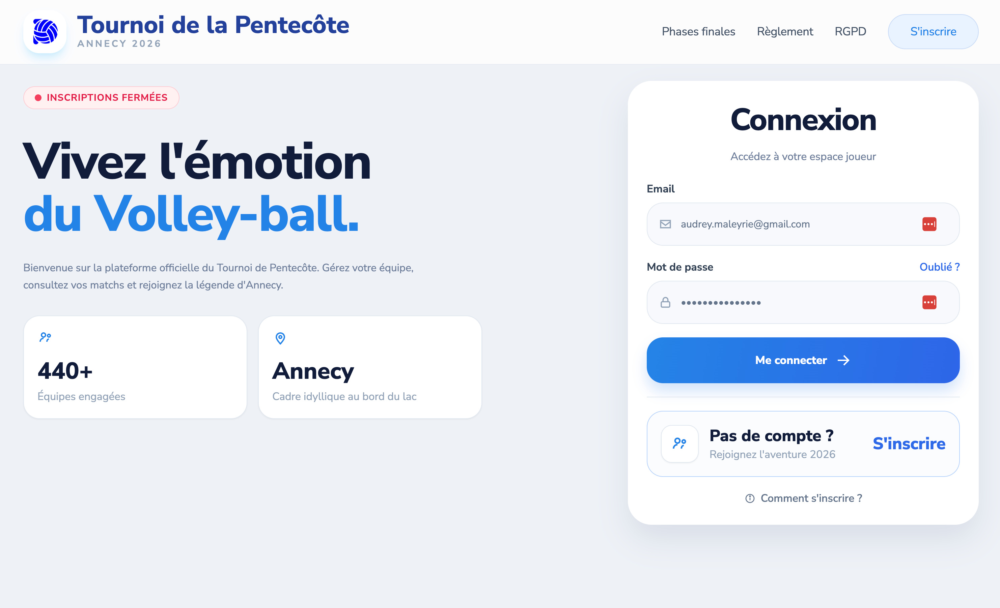
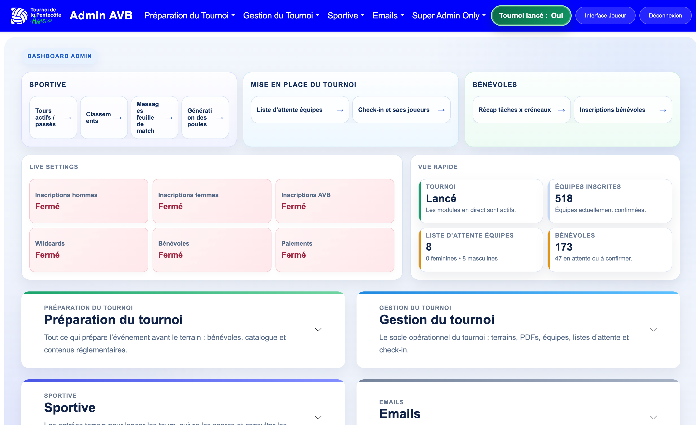
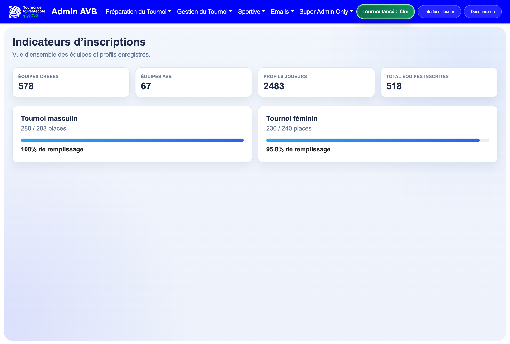
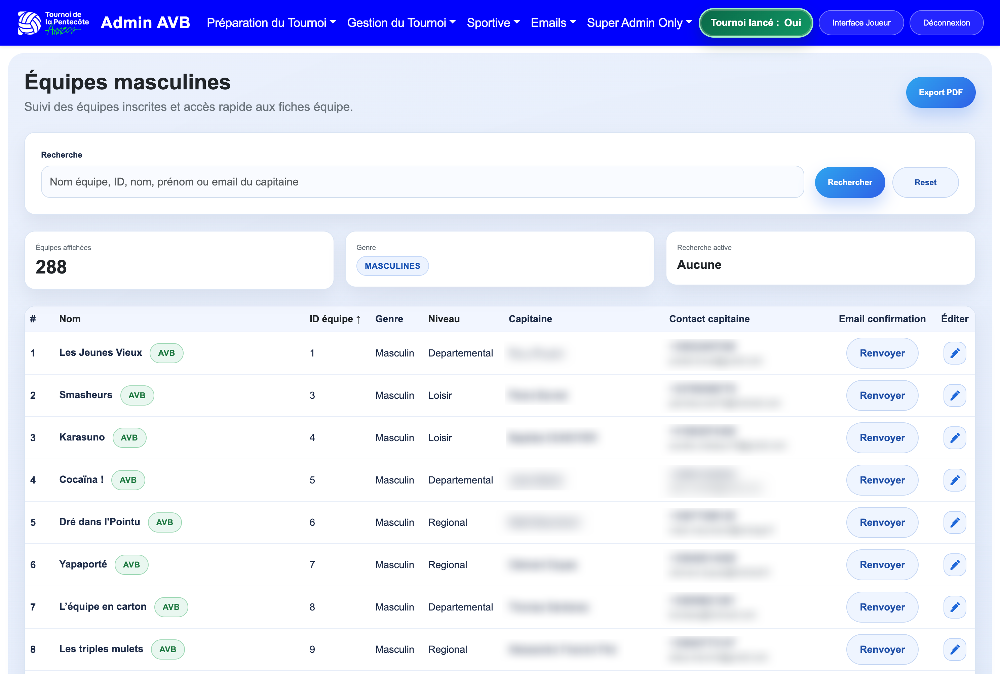
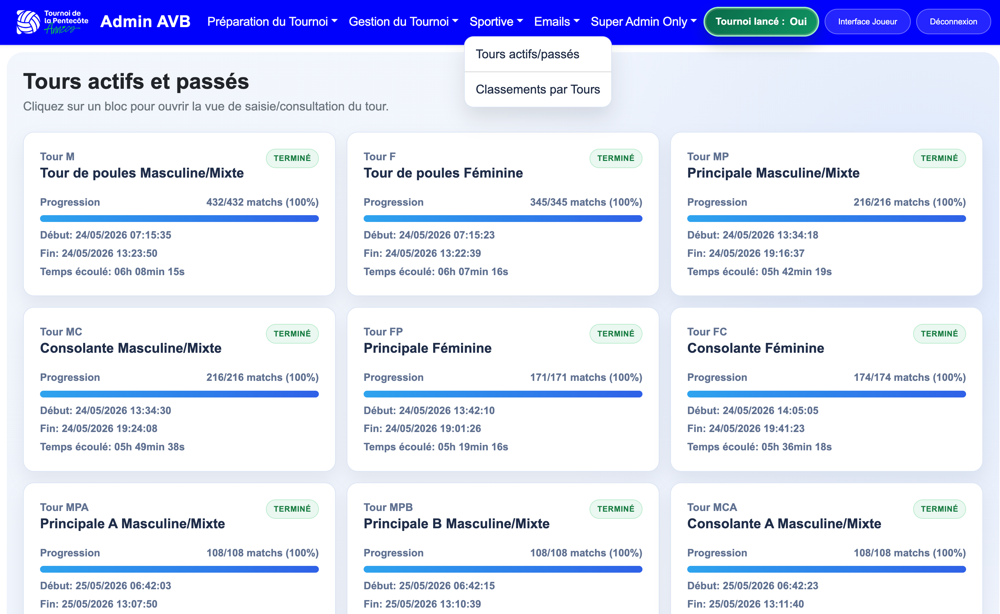
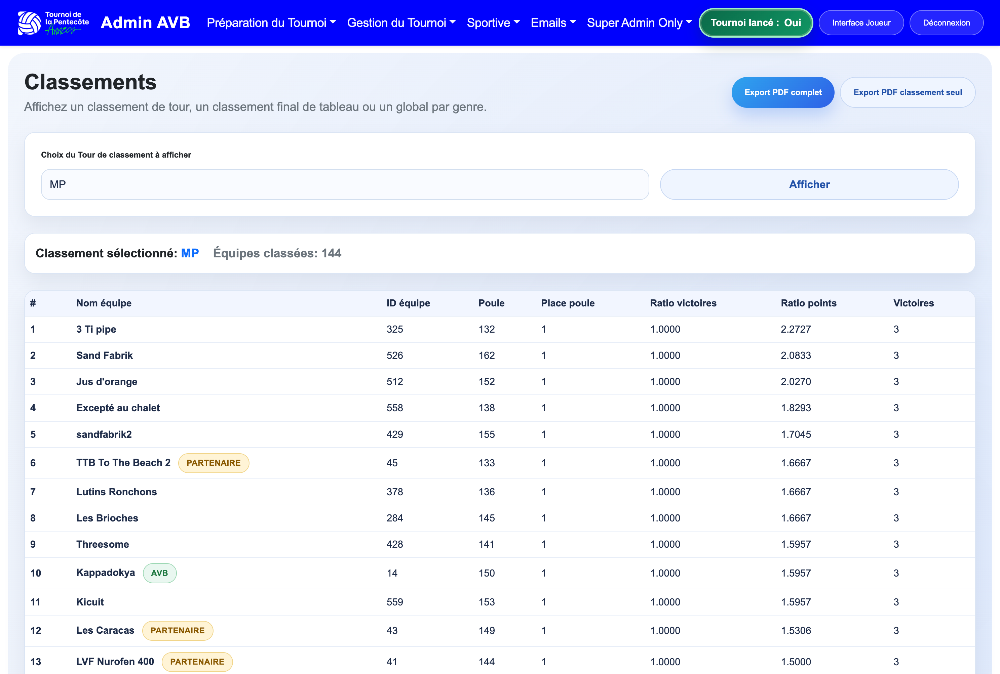
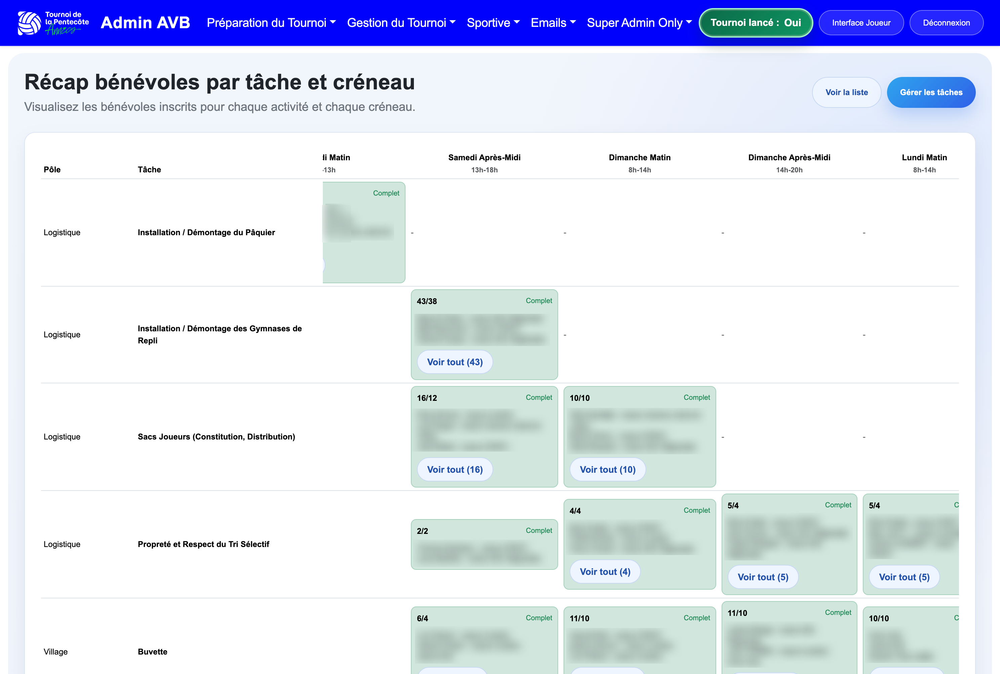

# Tournament Management Platform

🇬🇧 English | [🇫🇷 Français](README.fr.md)

### Sports Tournament Management Application

**PHP · Symfony · Doctrine ORM · JavaScript · Twig · Symfony Messenger · Docker**

A custom-built web application developed for **Annecy Volleyball**, a French volleyball club, to support the organization and management of its annual Pentecost tournament.

The platform handles the operational needs of a sports event, including participant registration, payments, team management, competition scheduling, match generation, score tracking, rankings, and volunteer coordination.

**Status: Fully functional application — ongoing improvements and new features planned.**

> **Private source code.** This repository serves as a technical case study, showcasing the application's features, architecture, and engineering challenges without exposing its proprietary code.

---
## Project at a Glance

The platform supports the organization of a large-scale volleyball tournament, handling:

- **More than 550 teams**.
- **Approximately 1,800 players**.
- **Registration capacity reached in under one hour** after registrations open.

This concentrated registration demand creates a significant technical challenge. The application must handle a high volume of concurrent requests while maintaining **registration reliability, data consistency, and capacity constraints**.

To address these requirements, the platform incorporates an access queue, database transactions, and pessimistic locking mechanisms.

## Project Background & Objectives

Organizing a volleyball tournament involves coordinating several interconnected processes:

- Managing participant and team registrations.
- Processing payments and controlling registration capacity.
- Organizing competition categories, groups, and matches.
- Assigning matches to available courts.
- Tracking results and calculating rankings.
- Coordinating volunteers and event operations.
- Generating administrative and competition documents.

The application centralizes these operations, helping organizers manage the event more efficiently.

## My Role & Contributions

**Lead contributor to the development and ongoing evolution of a PHP/Symfony application since 2021.**

According to GitHub contribution statistics reviewed in October 2026, my account @Noa83 accounts for **742 of the 831 recorded non-merge commits** on the main branch, approximately 89% of the total.

The application has been developed collaboratively, with contributions from several developers.

My involvement spans several technical areas:

- Back-end development and business logic implementation.
- Application maintenance and feature development.
- Database modeling and data management.
- Integration of external services and payment processing.
- Security and access management.
- Development and improvement of administrative features.
- Evolution of existing functionality and user interfaces.

### Tournament Scheduling Algorithm

The tournament scheduling algorithm was primarily designed and developed by **@L-Nicolet**, another contributor to the project.

My involvement in this component has been limited to minor adjustments and occasional maintenance.

Although the algorithm plays an important role in the platform, its design and primary implementation are not part of my personal achievements.

## Technical Architecture

| Area | Technologies |
|---|---|
| Back-end | PHP 8.2+, Symfony 7.4 |
| Persistence | Doctrine ORM, relational database |
| Front-end | Twig, JavaScript, CSS, Webpack Encore |
| Asynchronous processing | Symfony Messenger |
| Payment integration | Monetico |
| Document generation | PDF generation tools |
| Development environment | Docker |
| Security | Symfony Security, AES-256-GCM encryption |

The application follows a Symfony-based architecture structured around controllers, business services, Doctrine entities, and repositories.

The separation of responsibilities helps organize domain-specific operations such as registration management, payment processing, competition administration, and document generation.

### Architecture Overview

*High-level overview of the application's main components, business modules, external integrations, and processing flows.*

For a detailed explanation, see the [Technical Architecture documentation](docs/architecture.md).

## Main Features

### Registration & Participant Management

- Individual participant and team registration.
- Team creation and management.
- Registration capacity management.
- Waiting list management.
- Online registration payments.
- Participant administration.

### Tournament & Competition Management

- Competition categories and skill levels.
- Group and pool organization.
- Automated match generation.
- Team and court assignments.
- Management of different competition stages.
- Match result entry and tracking.
- Ranking and statistics calculation.
- Knockout-stage management.

### Event Administration

- Indoor and outdoor court management.
- Volunteer scheduling and task assignment.
- Team check-in and event reception management.
- Email communications and campaigns.
- PDF document and invoice generation.
- Tournament configuration and administration.

## Technical Challenges

The application addresses several technical challenges associated with managing a sports event.

The following sections describe the platform's technical characteristics. They do not imply that every component was designed or implemented by a single contributor.

### 1. Automated Match Scheduling

The tournament scheduling engine handles multiple business constraints:

- Team categories and competition levels.
- Group and pool composition.
- Court availability and assignment.
- Tournament stages and progression.
- Advancement through knockout rounds.

**Development attribution**

This component was primarily designed and developed by Loup, with limited subsequent contributions from my side.

It is included in this overview to illustrate the application's overall functional and architectural complexity, rather than as an example of my own algorithm design work.

### 2. Concurrent Registration Management

The opening of tournament registrations can generate a significant number of simultaneous requests.

The application includes an access queue to regulate registration traffic.

Database transactions and pessimistic locking mechanisms are used during payment confirmation and registration capacity checks to manage concurrent operations.

**Technical concepts:** concurrency management, Doctrine transactions, state management, and data consistency.

### 3. Personal Data Protection

The application implements several mechanisms to protect personal information, including:

- AES-256-GCM encryption for selected personal data fields.
- HMAC-based processing for certain email-related operations.
- Role-based access control for different user profiles.

**Technical concepts:** application security, applied cryptography, and access management.

### 4. Asynchronous Processing & Document Generation

Certain operations, including document generation and email communications, are handled through dedicated processing components.

Symfony Messenger is used to organize asynchronous tasks.

**Technical concepts:** application architecture, asynchronous processing, background jobs, and document generation.

## Technical Documentation

Explore the application's architecture, engineering challenges, and planned improvements through the following documents.

### [Technical Architecture](docs/architecture.md)

An overview of the Symfony application architecture, including its business services, Doctrine persistence layer, security mechanisms, payment integration, and asynchronous processing.

### [Technical Challenges & Engineering Decisions](docs/technical-challenges.md)

A closer look at the technical challenges addressed by the platform, including concurrent registrations, payment consistency, personal data protection, background processing, and long-term maintainability.

### [Product Roadmap](docs/roadmap.md)

An overview of upcoming and potential improvements, including player-submitted match scores, randomized team selection, and a front-end redesign.

## Application Screenshots

The following screenshots present selected views of the current AnnecyVB Tournament Management Platform.

The application is fully functional within its current scope. The interface shown here reflects the current production-ready state of the platform, while a front-end redesign is planned as part of the roadmap.

### Login & Player Access

*Public-facing login page for players, with tournament branding, registration access, and player account entry point.*

### Administration Dashboard

*Main administration dashboard, providing access to operational modules such as tournament setup, live settings, volunteer coordination, and tournament management.*

### Registration Indicators

*Overview of registration metrics, including created teams, registered teams, player profiles, and tournament occupancy.*

### Team Management

*Administrative view of registered teams, with search, filtering, export, and direct editing actions.*

### Match & Tournament Operations

*Overview of active and completed competition rounds, including progression status and timing information.*

### Rankings

*Ranking management interface, displaying standings by round with export capabilities.*

### Volunteer Management

*Volunteer recap view by task and time slot, supporting operational coordination during the tournament.*

**[Explore the full screenshot gallery](docs/screenshots.md)**

> Some screenshots contain blurred areas to preserve personal or sensitive information.

## Roadmap & Planned Improvements

The application is fully functional within its current scope.

Several enhancements are being considered to further improve the experience of participants, volunteers, and organizers.
For more information about the project's planned evolution,
see the [Product Roadmap](docs/roadmap.md).

### Player-Submitted Match Scores

A new interface is planned to allow players to submit match results directly.

Appropriate verification and validation mechanisms will be defined to maintain the reliability of competition results.

### Pre-Registration & Random Team Selection

A new pre-registration workflow is planned to allow teams to register their interest before final selection.

The selection process will incorporate a randomized draw, with eligibility, selection, and confirmation rules to be defined.

### Front-End Redesign

A redesign of the user interface is planned to improve usability, visual consistency, and the overall user experience.

Particular attention will be given to mobile accessibility and the needs of different user profiles.

### Continuous Improvement

Additional features may be introduced based on feedback and evolving requirements from participants, volunteers, and event organizers.

## Source Code & Confidentiality

The application source code is hosted in a private repository owned by the AnnecyVB organization.

This public repository is intended exclusively as a technical portfolio and case study.

It does not contain proprietary application code, personal information, payment credentials, or confidential organizational data.

---

**Project:** Annecy Volleyball — Pentecost Tournament

**Role:** Lead Contributor / Back-End Developer

**Period:** 2021 – Present

**Status:** Fully functional application, continuously evolving

**Source code:** Private