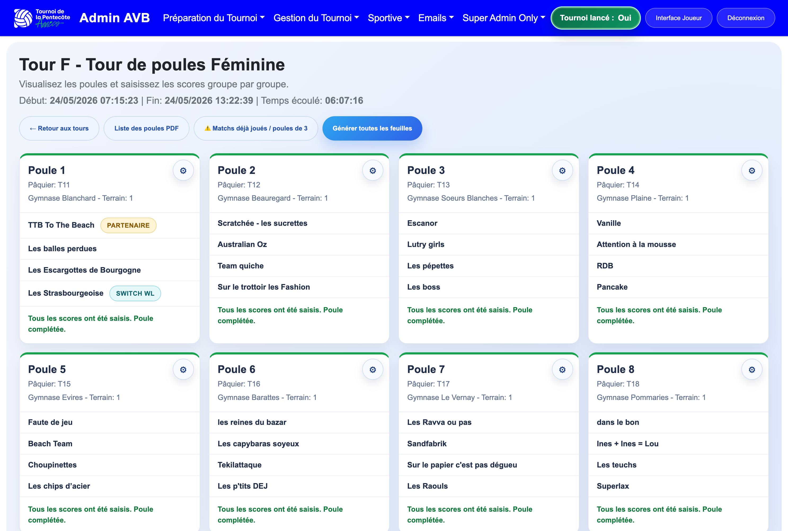
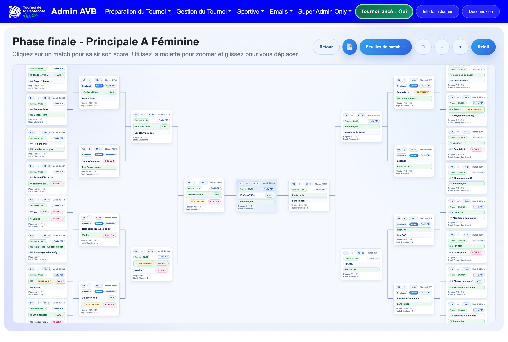
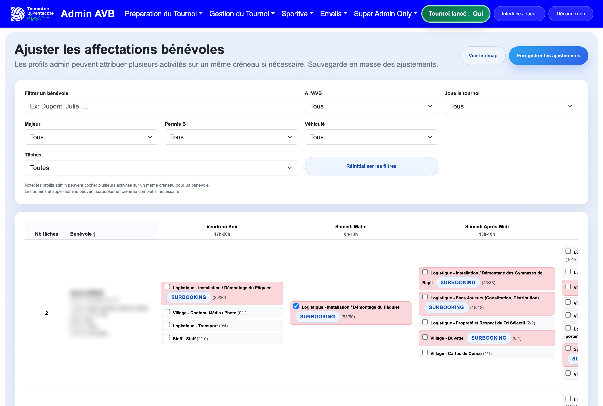
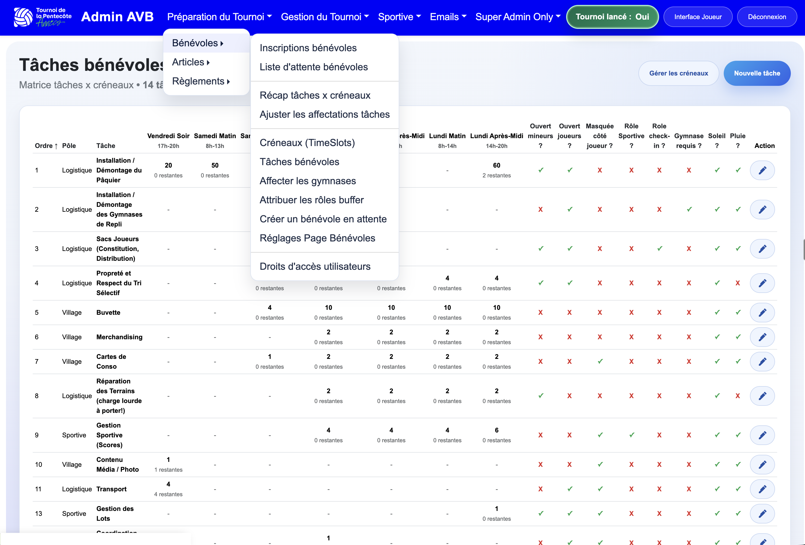

# Application Screenshots

This gallery presents the current interfaces of the AnnecyVB Tournament Management Platform.

The application is fully functional within its current scope. The screenshots below illustrate both the public-facing and administrative parts of the platform.

Some screenshots include blurred areas to preserve personal or sensitive information.

---

## 1. Public Access & Authentication

### Login Page

Public-facing login page for players, including tournament branding, registration access, and entry to the player space.

---

## 2. Administration Dashboard

### Main Dashboard

Main admin dashboard, centralizing access to operational sections such as tournament preparation, tournament management, sports operations, emails, and volunteer-related modules.

---

## 3. Registration Management

### Registration Indicators

Administrative overview of registration metrics, including created teams, player profiles, registered teams, and occupancy levels for the men's and women's tournaments.

---

## 4. Team Management

### Men's Teams Administration

Administrative list of registered teams with search, filters, export, confirmation resend, and edit actions.

---

## 5. Match Management & Competition Operations

### Active and Completed Rounds

Overview of active and completed rounds, with progression, start and end times, and elapsed duration.

### Pool Management View

Detailed view of a pool phase round, displaying pools, assigned venues, participating teams, and round completion status.

### Final Bracket View

Knockout-stage bracket view for the final phase, showing tournament progression and match structure.

---

## 6. Rankings & Results

### Rankings Interface

Standings interface showing ranking tables by selected round, with export actions and detailed ranking metrics.

---

## 7. Volunteer Management

### Volunteer Recap by Task and Time Slot

Operational recap of volunteer assignments by task and time slot, used to monitor coverage and staffing levels.

### Volunteer Assignment Adjustments

Administrative interface for adjusting volunteer assignments, applying filters, and managing task allocation across time slots.

### Volunteer Task Matrix

Configuration and management view for volunteer tasks, time slots, and related operational settings.

---

## 8. Notes on the Current Interface

The screenshots reflect the application's current user interface.

While the platform is fully functional, a front-end redesign is planned in order to improve:

- visual consistency,
- navigation clarity,
- responsive behavior,
- and overall user experience.

For planned improvements, see the [Product Roadmap](roadmap.md).